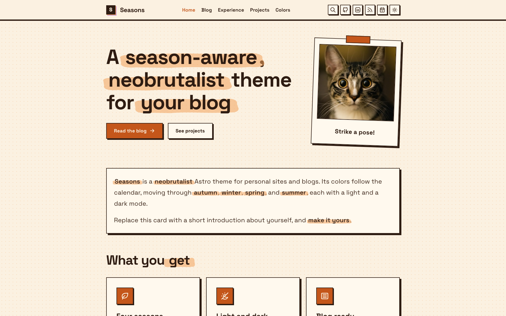
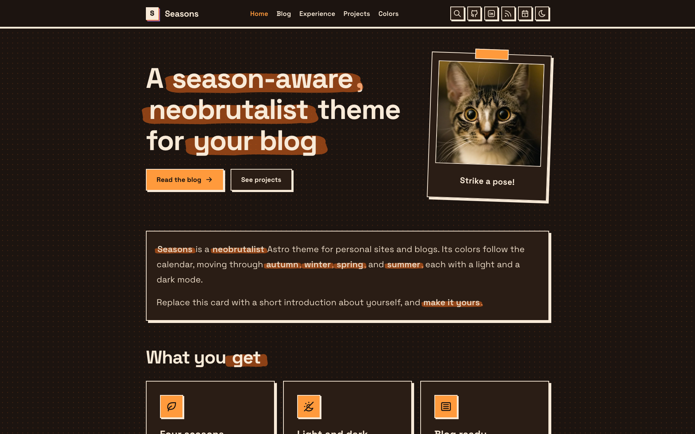
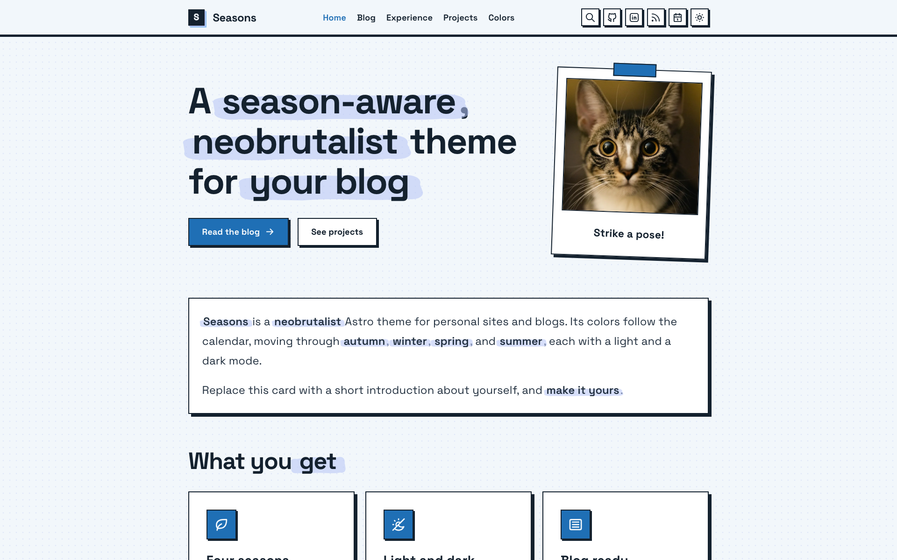
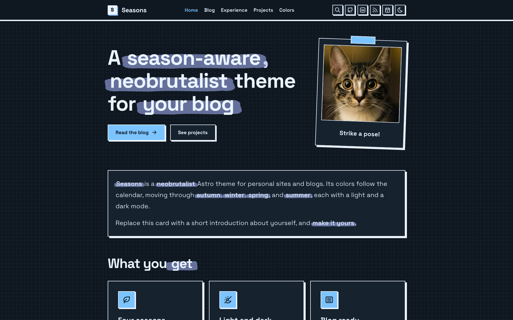
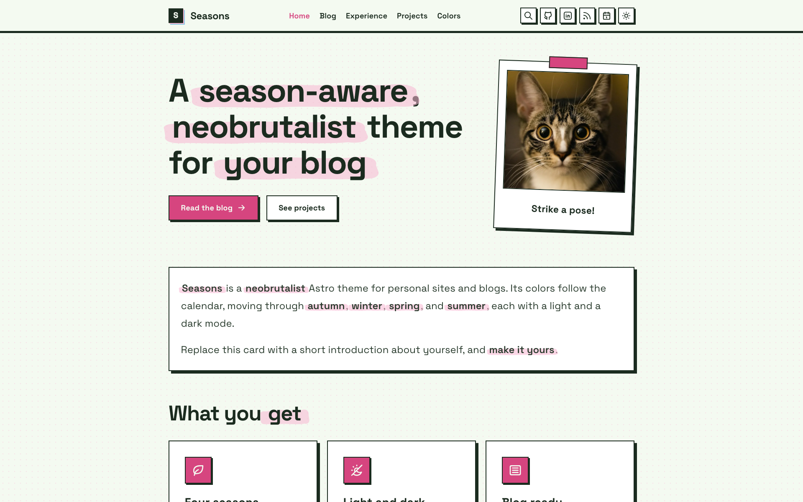
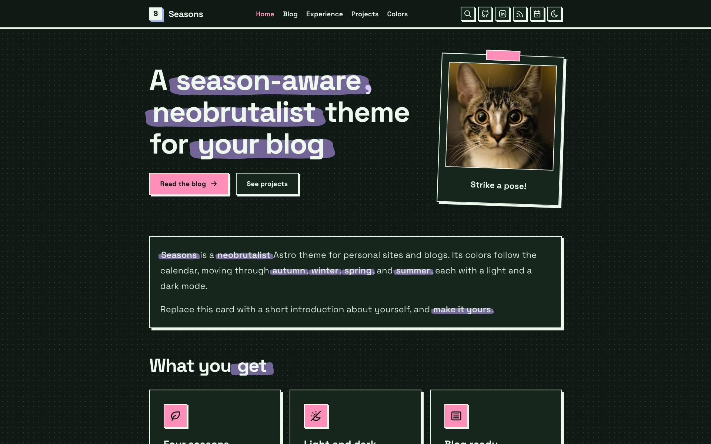
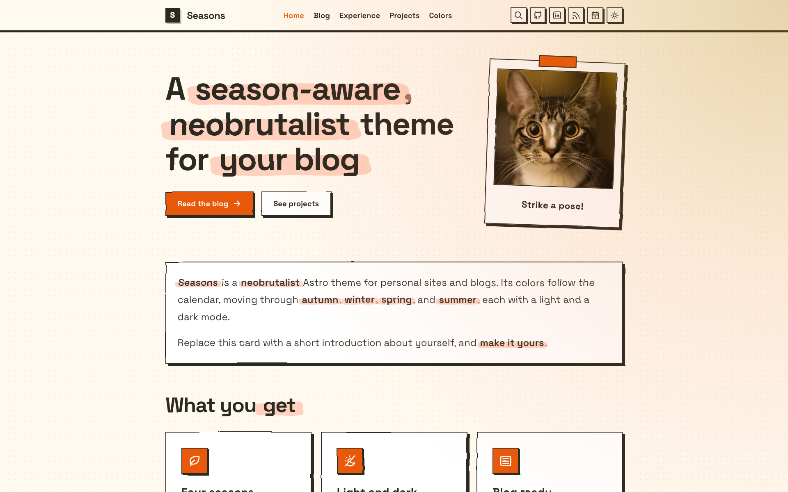
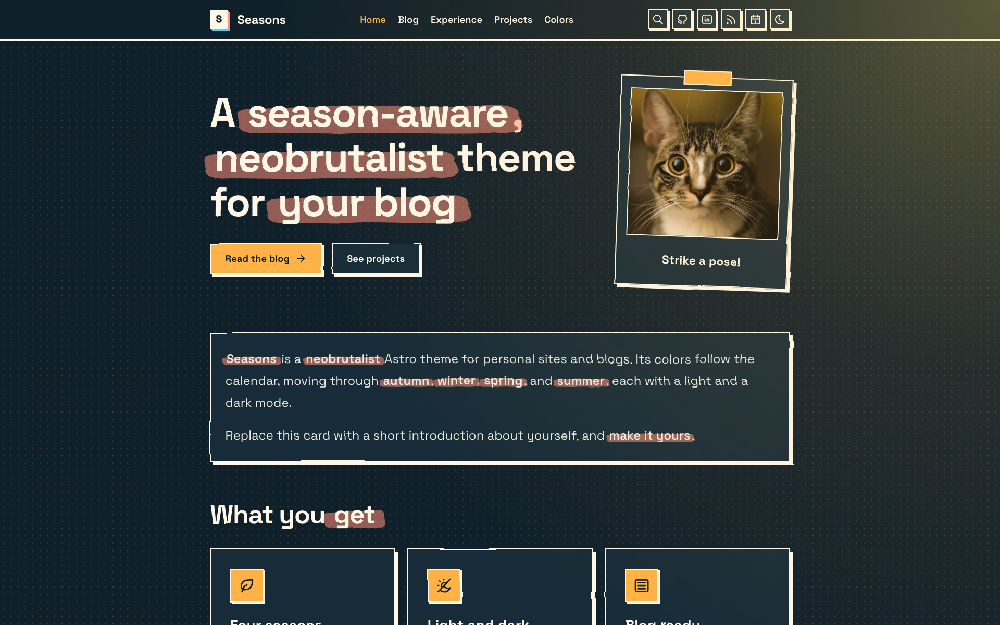

# Seasons

A season-aware neobrutalist theme for your blog, built with [Astro](https://astro.build/) and Tailwind CSS. The palette follows the calendar, with a light and a dark mode for every season. See the [screenshots](#seasonal-theme) below.

## Create a project from this template

Generate a new project from this repository with the Astro CLI. Use the package manager you prefer:

```sh
npm create astro@latest -- my-site --template nicomiguelino/astro-seasons
pnpm create astro@latest my-site --template nicomiguelino/astro-seasons
bun create astro@latest my-site --template nicomiguelino/astro-seasons
```

To use a specific branch or tag, append it to the template name: `--template nicomiguelino/astro-seasons#branch-name`.

The CLI copies the template, offers to install dependencies, and offers to initialize a git repository. Accept the git prompt (or run `git init` yourself before `npm install`) so the Husky pre-commit hook gets set up.

The template ships a `package-lock.json`. If you use another package manager, delete it and let your package manager generate its own lockfile. The scripts below work with any of them (for example `pnpm run dev` or `bun run dev`).

After generating:

1. Replace the placeholders in `src/lib/site.ts` (`SITE_NAME`, `AUTHOR_NAME`, `SITE_URL`, `GITHUB_URL`, and so on). `astro.config.mjs` reads `SITE_URL` from there.
2. Set `SOURCE_URL` in `src/lib/site.ts` to the repository that builds your site (see [License](#license)).
3. If you deploy to a sub-path (a GitHub Pages project page at `https://<user>.github.io/<repo>/`), see [Deploying under a sub-path](#deploying-under-a-sub-path).
4. Replace the example posts in `src/content/blog/` and the pages under `src/pages/` (such as `experience/` and `projects/`) with your own content.

Prefer to work from a clone? Run `git clone https://github.com/nicomiguelino/astro-seasons.git` and follow the steps below.

## Getting started

Install the dependencies and run the project:

```sh
npm install
npm run dev           # dev server on :4321
npm run build         # production build
npm run preview       # preview the production build
npm run check         # astro type checking
npm run lint:check    # lint with ESLint
npm run lint:fix      # lint and apply safe fixes
npm run format:check  # check formatting with Prettier
npm run format:fix    # format files with Prettier
npm run test:e2e      # Playwright E2E and screenshot tests
```

> [!NOTE]
> `npm install` also sets up a Husky pre-commit hook that runs `lint:check`, `format:check`, and `check`. Fix failures before committing.

## Seasonal theme

The site switches palettes by date. Every family has a light and a dark variant, defined in `src/styles/palettes.css`:

- `neon-*`: not tied to a date, only available from the theme picker
- `autumn-*`: used from Sept 22 to Dec 21
- `winter-*`: used from Dec 22 to Mar 19
- `spring-*`: used from Mar 20 to Jun 20
- `summer-*`: used from Jun 21 to Sept 21

|        | Light                                              | Dark                                             |
| ------ | -------------------------------------------------- | ------------------------------------------------ |
| Autumn |  |  |
| Winter |  |  |
| Spring |  |  |
| Summer |  |  |

How it works:

- The family is picked from the visitor's local date on every page load, so no rebuild is needed when a season starts or ends.
- The mode (light or dark) comes from the theme toggle, falling back to `prefers-color-scheme`. Only the mode is stored (`site-mode` in `localStorage`), so a saved preference carries across seasons.
- The legacy `site-palette` value is migrated to `site-mode` and removed.
- `initializePalette()` in `src/lib/palette.ts` sets `data-palette` on `<html>`. `Layout.astro` calls it from `<head>`, and `body` stays hidden until the attribute is set (visible when scripting is off) to avoid a flash of the wrong colors.
- The theme toggle switches between light and dark within the active family.
- The theme picker in the navbar (before the light/dark toggle) overrides the date: Automatic (follow the date, the default), Autumn, Winter, Spring, Summer (under a "Seasons" divider), or Neon (under an "Other" divider). The choice is stored in `localStorage` as `site-theme` (removed for Automatic), and the matching falling effect follows it.

Autumn, winter and spring each have a falling effect on the home page (`FallingLeaves`, `FallingSnow`, `FallingPetals`). Summer has two ambient effects instead: `HeatShimmer` (an SVG displacement filter that makes the page content shimmer) and `Sunlight` (a pulsing warm glow in the top-right corner). Every effect is shown only under its palettes and when `prefers-reduced-motion` allows it.

To change the dates, edit `seasons` in `PALETTE_CONFIG` (`MMDD` numbers, inclusive; a range with `start` after `end` wraps the new year). To add a season, add it to `THEME_CHOICES` and the picker options in `src/components/header/ThemePicker.astro`, then add `[data-palette='<name>-light']` and `<name>-dark` blocks to `palettes.css`, add its name to `PaletteFamily`, and add its range to `seasons`.

To preview a season, set it in the browser console, e.g. `document.documentElement.dataset.palette = 'autumn-dark'`.

## Testing

Tests use [Playwright](https://playwright.dev) and live in `src/tests/`:

- `src/tests/e2e/`: behavior checks, e.g. the home page title and which falling particles show in each season
- `src/tests/screenshots/`: captures the home, blog, blog post, experience, projects, tags and 404 pages in light and dark, one spec per page
- `src/tests/fixtures/blog/`: fixture posts the Playwright build uses in place of the real ones

Set up once per machine:

```sh
npx playwright install chromium
```

Then run the tests. Playwright builds the site and serves it with `astro preview` on port 4322, so it never collides with the dev server on :4321:

```sh
npm run test:e2e                                        # everything
npx playwright test src/tests/e2e                       # E2E only
npx playwright test src/tests/screenshots               # screenshots only
npx playwright test --ui                                # interactive runner
npx playwright show-report                              # open the last HTML report
```

### Screenshots

- Each of those pages is captured at 1920x1200 in light and dark. The home page is captured once for each season, and the other pages in summer only.
- The clock is pinned (July 15 for summer, Oct 15 for autumn, Jan 15 for winter, Apr 15 for spring), so results don't depend on today's date.
- `falling-particles` captures the home page with the falling effects frozen mid-fall (autumn, winter and spring; summer has no particles), since the other screenshots disable animations and so hide the particles. Names look like `falling-particles-autumn-dark.png`.
- The color scheme is emulated with `prefers-color-scheme`.
- Content is pinned too. The Playwright build sets `USE_FIXTURE_POSTS`, which makes the content collection in `src/content.config.ts` load the posts in `src/tests/fixtures/blog/` instead of `src/content/blog/`. Adding or editing a real post leaves `screenshots/` unchanged, and `blog-post` points at `/blog/fixture-post-one/`.
- Fixture posts have fixed titles, tags, and dates. Edit them only when a screenshot should change, and keep a word like "tool" in one of them, since the search E2E spec queries it.
- Screenshots are written to `screenshots/` (overwriting the previous ones) and are not part of the deployed site. Names look like `home-autumn-dark.png` and `blog-post-summer-dark.png`.
- They are captured, not compared, so the tests don't fail on visual changes. Review the images in `git diff` before committing.
- To capture another page, create `src/tests/screenshots/<page>.spec.ts` that calls `defineScreenshotTests('<page>', '/<path>/')` from `./support`. Pass `[SUMMER_SEASON, AUTUMN_SEASON, WINTER_SEASON, SPRING_SEASON]` as a third argument to cover every palette.

The `Checks` workflow runs lint, format, and E2E as parallel jobs after a shared dependency setup, on pushes and pull requests to `main`. It can also be started manually.

## Deploying under a sub-path

Served from the root of a domain (a `<user>.github.io` repository or a custom domain), the site needs no extra setup. Served from a sub-path (a GitHub Pages project page at `https://<user>.github.io/<repo>/`), set two environment variables at build time:

```sh
SITE_URL=https://<user>.github.io BASE_PATH=/<repo> npm run build
```

`astro.config.mjs` passes them to Astro's `site` and `base` options. With neither set, the build is for a domain root. `.github/workflows/deploy.yml` sets both from the repository owner and name and deploys to GitHub Pages. To use it for your own copy, remove the `if: github.repository == ...` line, then set **Settings > Pages > Source** to **GitHub Actions**.

Astro's `base` only rewrites URLs that Astro generates itself (stylesheets, scripts, and fonts referenced from CSS). Root-absolute paths you write by hand are not rewritten, so wrap them with `withBase()` from `src/lib/paths.ts`:

```astro
---
import { withBase } from '@/lib/paths';
---

<a href={withBase('/blog/')}>Blog</a>
```

This applies to `href`, `src`, and `fetch` URLs in `.astro` and `.ts` files. In Markdown, use relative links (for example `../markdown-features/`) so they work under any base. `withBase()` returns the path unchanged when there is no base.

## Customizing

Site-wide values (site name, author name, description, job title, site URL, the GitHub and LinkedIn profile links, and the blog, tags, experience, and projects page descriptions) live in `src/lib/site.ts`. The header, footer, page titles, RSS feed, search, and structured data all read from it, and the letter in the header logo is the first character of `SITE_NAME`. Everything else to customize:

- `src/components/header/index.astro` and `src/components/layout/Footer.astro`: navigation, header icons, footer
- `src/pages/index.astro`: the home page heading and the intro card
- `src/components/experience/` and `src/pages/experience/index.astro`: the experience page. Each job is one component built on `ExperienceEntry.astro`. Rename, edit, or add components, then list them in `src/components/experience/index.astro`
- `src/components/projects/` and `src/lib/projects.ts`: the projects page. Edit the `projects` array in `index.astro` (name, description, technologies, and a `links` array of `{ kind, url }`, with an optional `isCooking` flag), add link kinds in `src/lib/projects.ts`, and update the matching body in `src/lib/search.ts`
- `src/lib/search.ts`: the search entries for the static pages (home, blog, tags, experience, projects). Their descriptions come from `site.ts`, but the home, experience, and projects bodies are plain text, so update them when you change those pages
- `public/favicon.svg`: the tab icon, a static file that doesn't follow `SITE_NAME`, so replace it with your own
- `src/lib/palette.ts`: the seasonal palette logic and its config (storage keys, season dates); see [Seasonal theme](#seasonal-theme)
- `src/lib/colors.ts`: the color tokens listed on the `/colors/` page; add a token here when you add one to `src/styles/palettes.css`
- `public/robots.txt`: the sitemap URL (a static file, so it can't import from `site.ts`). Crawlers only read `robots.txt` at the root of a domain, so it has no effect on a sub-path deploy
- `public/assets/og.png`: social preview image, 1200x630. It's a screenshot of the autumn home page, so replace it with your own

## Writing posts

Posts are markdown files in `src/content/blog/` with `title`, `description`, `date`, optional `tags`, and optional `draft` frontmatter. Each tag links to its archive page under `/tags/`. `markdown-features.md` shows the frontmatter and every supported markdown feature, and `make-it-yours.md` is a short customization guide. Delete both when you add your own posts.

## Project structure

```
src/
  components/     # reusable UI, grouped by feature (props are documented in each component's frontmatter)
  content/blog/   # posts as markdown
  lib/            # post and tag helpers, palette config, particle shapes, color token list, site constants
  pages/          # index (home), blog/, experience/, projects/, colors/, tags/, 404, rss
  styles/         # global styles, design tokens, palette definitions (Tailwind CSS)
  tests/          # Playwright specs: e2e/ and screenshots/
screenshots/      # committed screenshot baselines (not deployed)
public/
  assets/         # font, og image
```

## License

[AGPL-3.0-or-later](LICENSE).

This project is a modified version of [astro-palette](https://github.com/joshruggles/astro-palette) by Josh Ruggles, which is also licensed under AGPL-3.0-or-later. It was modified by Nico Miguelino in 2026. The changes include the season-aware themes and seasonal effects, the neobrutalist design, Tailwind CSS, Fuse.js search, the added pages and components, and the linting, formatting, and testing setup. The full change history is in this repository's git log.

If you deploy a modified version of this project as a website, [AGPL-3.0 section 13](https://www.gnu.org/licenses/agpl-3.0.html#section13) requires you to offer your users the corresponding source code, for example with a link to your repository in the site footer. The site name in the footer already links to the source; set `SOURCE_URL` in `src/lib/site.ts` to the repository that builds your site.

With thanks to:

- [astro-palette](https://github.com/joshruggles/astro-palette) by Josh Ruggles, the template this site was generated from (AGPL-3.0-or-later)
- [herdr](https://github.com/ogulcancelik/herdr) by Oğulcan Çelik, the website theme this one grew out of, and the reason it is AGPL-3.0-or-later
- Style: [Neubrutalism](https://neubrutalism.com/), the design style behind the hard borders, offset shadows, and bold colors
- Font: [JetBrains Mono](https://www.jetbrains.com/lp/mono/), under the [SIL Open Font License 1.1](https://github.com/JetBrains/JetBrainsMono/blob/master/OFL.txt)
- Icons: [Tabler Icons](https://tabler.io/icons) (MIT)
- Home page photo: [Mark Olsen](https://unsplash.com/photos/a-close-up-of-a-cat-looking-at-the-camera-rj4KLIcDwwc) on Unsplash
- Search: [Fuse.js](https://www.fusejs.io) (Apache-2.0)
