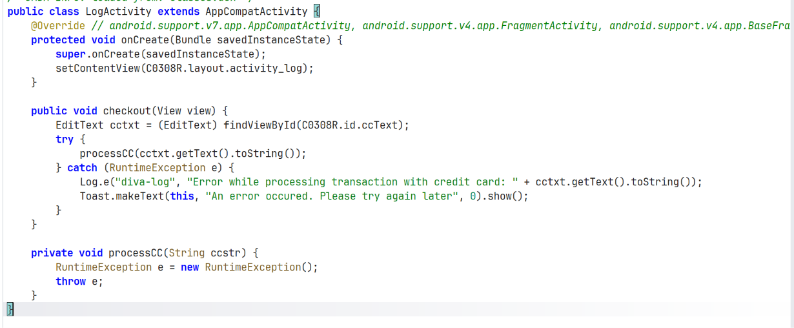
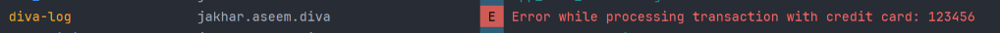

# Insecure Logging

Activity `LogActivity` sẽ tương tác với thành phần `EditText`, chính là ô input của user. Sau đó, hàm call `processC()`. Hàm này mặc định ném 1 RuntimeException và khi `checkout()` bắt được, hàm sẽ ghi vào log gồm dòng string + `cctxt`. Đây sẽ là thông tin nhạy cảm của user và gây nguy hiểm nếu người khác có quyền truy cập log.

