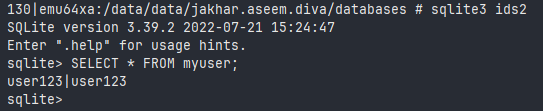
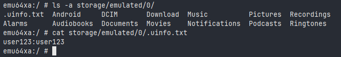

# Insecure Logging

```java
public void checkout(View view) {
    EditText cctxt = (EditText) findViewById(C0308R.id.ccText);
    try {
        processCC(cctxt.getText().toString());
    } catch (RuntimeException e) {
        Log.e("diva-log", "Error while processing transaction with credit card: " + cctxt.getText().toString());
        Toast.makeText(this, "An error occured. Please try again later", 0).show();
    }
}
private void processCC(String ccstr) {
    RuntimeException e = new RuntimeException();
    throw e;
}
```

Activity `LogActivity` sẽ tương tác với thành phần EditText, chính là ô input của user. Sau đó, hàm call `processCC()`. Hàm này mặc định ném 1 RuntimeException và khi `checkout()` bắt được, hàm sẽ ghi vào log gồm dòng `"Error while processing transaction with credit card:" + cctxt`. Đây sẽ là thông tin nhạy cảm của user và gây nguy hiểm nếu người khác có quyền truy cập log.

```
2026-11-12 09:00:14.456 20755-20755 diva-log jakhar.aseem.diva Error while processing transaction with credit card: 1234562
```

# Hardcoding issues 

Challenge chỉ đơn giản là điền đúng credential = `vendorsecretkey` thì sẽ thoả điều kiện.

```java
EditText hckey = (EditText) findViewById(C0308R.id.hcKey);
if (hckey.getText().toString().equals("vendorsecretkey")) {
    Toast.makeText(this, "Access granted! See you on the other side :)", 0).show();
} else {
    Toast.makeText(this, "Access denied! See you in hell :D", 0).show();
}
```

# Insecure Data Storage - Part 1

Hàm xử lý 2 chuỗi `Username` và `Password`:

```java
public void saveCredentials(View view) {
    SharedPreferences spref = PreferenceManager.getDefaultSharedPreferences(this);
    SharedPreferences.Editor spedit = spref.edit();
    EditText usr = (EditText) findViewById(C0308R.id.ids1Usr);
    EditText pwd = (EditText) findViewById(C0308R.id.ids1Pwd);
    spedit.putString("user", usr.getText().toString());
    spedit.putString("password", pwd.getText().toString());
    spedit.commit();
    Toast.makeText(this, "3rd party credentials saved successfully!", 0).show();
}
```

Hàm này lưu 2 credential của user nhập vào `SharedPreferences`, đây là API của Android cho phép lưu các thông tin vặt (có thể chỉ dùng cho mục đích ngắn hạn). `Username` thì lưu vào key có tên là `user`, `Password` thì là `password`. Sơ hở là nếu attacker của quyền root device thì có thể truy cập `SharedPreferences` và lộ `Username`, `Password` nếu developer lưu trữ dữ liệu bằng cách này. 

Ta có thể truy cập file `.xml` bằng adb:


# Insecure Data Storage - Part 2

Ý tưởng cũng tương tự Part 1 nhưng lần này lưu dữ liệu trong `SQLite database`.

Ta có thể xem ở `/data/data/jakhar.aseem.diva/databases/ids2`:



# Insecure Data Storage - Part 3

Ý tưởng cũng tương tự Part 1, 2. Lần này lưu dữ liệu trong file `tmp`.


# Insecure Data Storage - Part 4

Lần này ứng dụng ghi vào `External Storage (/strorage)`, là thư mục nằm ngoài ứng dụng. Lưu ý: các Android API version mới có thể không có quyền ghi vào thư mục này, khi này ta cần thêm quyền cho thư mục.



