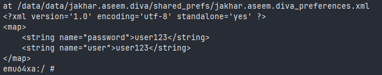
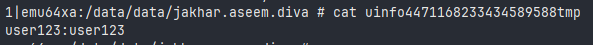

# Insecure Logging

```java
public void checkout(View view) {
    EditText cctxt = (EditText) findViewById(C0308R.id.ccText);
    try {
        processCC(cctxt.getText().toString());
    } catch (RuntimeException e) {
        Log.e("diva-log", "Error while processing transaction with credit card: " + cctxt.getText().toString());
        Toast.makeText(this, "An error occured. Please try again later", 0).show();
    }
}
private void processCC(String ccstr) {
    RuntimeException e = new RuntimeException();
    throw e;
}
```

The `LogActivity` activity interacts with the EditText component, which is the user's input field. Then, the code calls `processCC()`. This function by default throws a RuntimeException, and when `checkout()` catches it, the function writes to the log the line `"Error while processing transaction with credit card:" + cctxt`. This is the user's sensitive information and is dangerous if someone else has access to the log.

```
2026-11-12 09:00:14.456 20755-20755 diva-log jakhar.aseem.diva Error while processing transaction with credit card: 1234562
```

# Hardcoding issues

The challenge is simply to enter the correct credential = `vendorsecretkey` to satisfy the condition.

```java
EditText hckey = (EditText) findViewById(C0308R.id.hcKey);
if (hckey.getText().toString().equals("vendorsecretkey")) {
    Toast.makeText(this, "Access granted! See you on the other side :)", 0).show();
} else {
    Toast.makeText(this, "Access denied! See you in hell :D", 0).show();
}
```

# Insecure Data Storage - Part 1

The function handles the two strings `Username` and `Password`:

```java
public void saveCredentials(View view) {
    SharedPreferences spref = PreferenceManager.getDefaultSharedPreferences(this);
    SharedPreferences.Editor spedit = spref.edit();
    EditText usr = (EditText) findViewById(C0308R.id.ids1Usr);
    EditText pwd = (EditText) findViewById(C0308R.id.ids1Pwd);
    spedit.putString("user", usr.getText().toString());
    spedit.putString("password", pwd.getText().toString());
    spedit.commit();
    Toast.makeText(this, "3rd party credentials saved successfully!", 0).show();
}
```

This function saves the two credentials entered by the user into `SharedPreferences`, which is the Android API that allows storing miscellaneous information (possibly only for short-term purposes). `Username` is stored in a key named `user`, and `Password` is stored in `password`. The weakness is that if an attacker has root access to the device, they can access `SharedPreferences` and expose `Username` and `Password` if the developer stores data this way.

We can access the `.xml` file using adb:



# Insecure Data Storage - Part 2

The idea is similar to Part 1, but this time the data is stored in a `SQLite database`.

We can view it at `/data/data/jakhar.aseem.diva/databases/ids2`:


# Insecure Data Storage - Part 3

The idea is also similar to Parts 1 and 2. This time the data is stored in a `tmp` file.



# Insecure Data Storage - Part 4

This time the application writes to `External Storage (/strorage)`, which is a directory outside the application. Note: newer Android API versions may not have permission to write to this directory; in that case we need to add permission for the directory.


