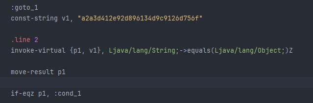
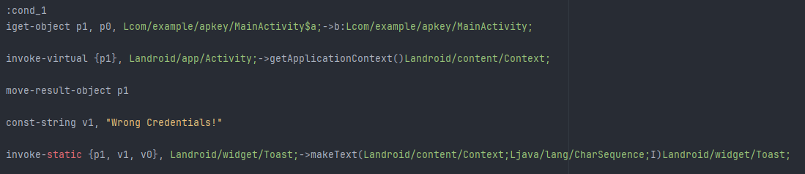
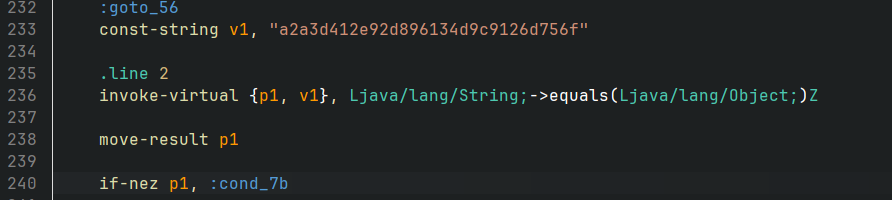
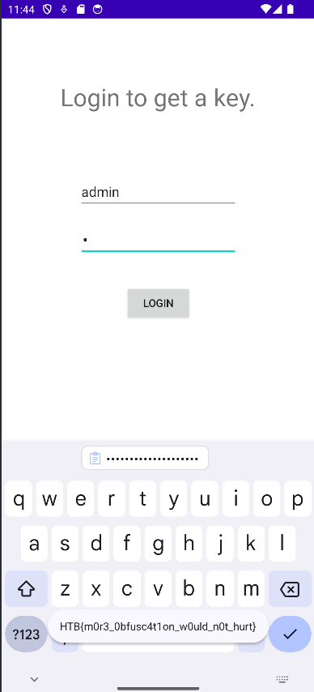
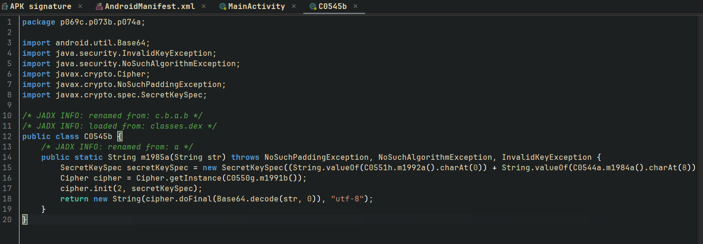

# APKey

After installing the apk file into the emulator, we can see a login page with `Username` and `Password`. Check `MainActivity` in the `onClick()` function to see what event happens when the submit button is pressed.

```java
public void onClick(View view) {
    Toast toastMakeText;
    String string;
    try {
        if (MainActivity.this.name.getText().toString().equals("admin")) {
            MainActivity mainActivity = MainActivity.this;
            C0545b c0545b = mainActivity.f3950e;
            String string2 = mainActivity.password.getText().toString();
            try {
                MessageDigest messageDigest = MessageDigest.getInstance("MD5");
                messageDigest.update(string2.getBytes());
                byte[] bArrDigest = messageDigest.digest();
                StringBuffer stringBuffer = new StringBuffer();
                for (byte b2 : bArrDigest) {
                    stringBuffer.append(Integer.toHexString(b2 & 255)); // 0xff | 0b11111111
                }
                string = stringBuffer.toString();
            } catch (NoSuchAlgorithmException e) {
                e.printStackTrace();
                string = "";
            }
            if (string.equals("a2a3d412e92d896134d9c9126d756f")) {
                Context applicationContext = MainActivity.this.getApplicationContext();
                MainActivity mainActivity2 = MainActivity.this;
                C0545b c0545b2 = mainActivity2.f3950e;
                C0550g c0550g = mainActivity2.f3951f;
                toastMakeText = Toast.makeText(applicationContext, C0545b.m1985a(C0550g.m1990a()), 1);
            } else {
                toastMakeText = Toast.makeText(MainActivity.this.getApplicationContext(), "Wrong Credentials!", 0);
            }
        } else {
            toastMakeText = Toast.makeText(MainActivity.this.getApplicationContext(), "Wrong Credentials!", 0);
        }
        toastMakeText.show();
    } catch (Exception e2) {
        e2.printStackTrace();
    }
}
```

If we do not encounter "Wrong Credentials!", then `Username` must be `admin`.

As for `Password`, the program initializes an `MD5` hash. From what we learned, this is a one-way hash, so the check condition `string.equals("a2a3d412e92d896134d9c9126d756f")` is hard to reverse. Therefore, we use the approach of modifying the program's smali code so that it branches to the other direction; even if the value is not equal to `a2a3d412e92d896134d9c9126d756f`, it can still be bypassed.



The code compares using the `equals()` function, which returns a Boolean value and stores it in `p1`. The check `if-eqz` = `if equal zero` - if `p1` = 0, it jumps to `cond_1`, which is the `Wrong Credentials!` branch.



=> Changing the smali from `if-eqz` to `if-nez (if not equal zero)` will bypass this check branch.

After changing it, check the decompiled source code in Jadx:



Then I try entering `Username: admin` and `Password: 1`



The program prints the Flag via a Toast; I try checking the method that returns the Flag.



The function returns a string; this string is decoded using `Base64`, and the `secretKeySpec` part is created from multiple strings in different classes.
