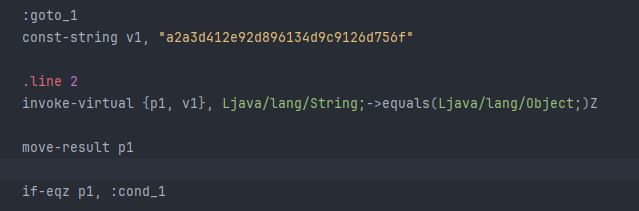
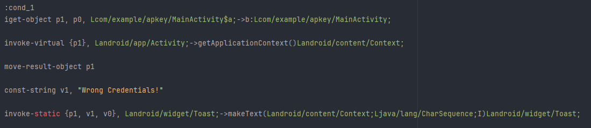

# APKey

Sau khi install file apk vào emulator thì có thể thấy trang login với `Username` và `Password`. Kiểm tra `MainActivity` ở hàm `onClick()` để xem sự kiện gì diễn ra khi ấn nút submit.

```java
public void onClick(View view) {
    Toast toastMakeText;
    String string;
    try {
        if (MainActivity.this.name.getText().toString().equals("admin")) {
            MainActivity mainActivity = MainActivity.this;
            C0545b c0545b = mainActivity.f3950e;
            String string2 = mainActivity.password.getText().toString();
            try {
                MessageDigest messageDigest = MessageDigest.getInstance("MD5");
                messageDigest.update(string2.getBytes());
                byte[] bArrDigest = messageDigest.digest();
                StringBuffer stringBuffer = new StringBuffer();
                for (byte b2 : bArrDigest) {
                    stringBuffer.append(Integer.toHexString(b2 & 255)); // 0xff | 0b11111111
                }
                string = stringBuffer.toString();
            } catch (NoSuchAlgorithmException e) {
                e.printStackTrace();
                string = "";
            }
            if (string.equals("a2a3d412e92d896134d9c9126d756f")) {
                Context applicationContext = MainActivity.this.getApplicationContext();
                MainActivity mainActivity2 = MainActivity.this;
                C0545b c0545b2 = mainActivity2.f3950e;
                C0550g c0550g = mainActivity2.f3951f;
                toastMakeText = Toast.makeText(applicationContext, C0545b.m1985a(C0550g.m1990a()), 1);
            } else {
                toastMakeText = Toast.makeText(MainActivity.this.getApplicationContext(), "Wrong Credentials!", 0);
            }
        } else {
            toastMakeText = Toast.makeText(MainActivity.this.getApplicationContext(), "Wrong Credentials!", 0);
        }
        toastMakeText.show();
    } catch (Exception e2) {
        e2.printStackTrace();
    }
}
```

Nếu không gặp "Wrong Credentials!" thì `Username` phải là `admin`.

Còn ở `Password`, chương trình khởi tạo bộ hash `MD5`. Theo tìm hiểu thì đây là dạng hash 1 chiều nên điều kiện check `string.equals("a2a3d412e92d896134d9c9126d756f")` khó mà reverse được. Nên ta sử dụng cách đổi code smali của chương trình sao cho rẽ hướng sang nếu không bằng `a2a3d412e92d896134d9c9126d756f` cũng có thể bypass.



Code so sánh bằng hàm `equals()`, sẽ trả về giá trị Boolean và lưu vào `p1`. Check `if-eqz` = `if equal zero` - nếu `p1` = 0 thì nhảy đế `cond_1`, đây là nhánh `Wrong Credentials!`



=> Đổi smali từ `if-eqz` thành `if-nez (if not equal zero)` sẽ bypass được nhánh check này.
