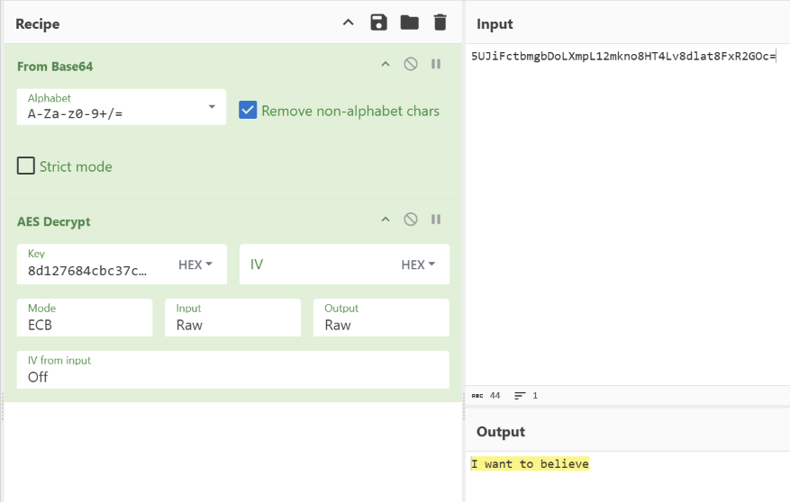
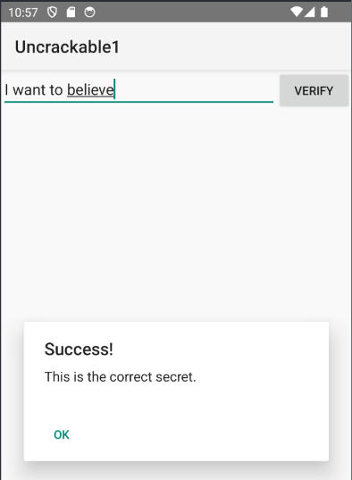

# Android UnCrackable L1

Đầu tiên, kiểm tra source code của MainActivity:

```java
public class MainActivity extends Activity {
    /* JADX INFO: renamed from: a */
    private void m5a(String str) {
        AlertDialog alertDialogCreate = new AlertDialog.Builder(this).create();
        alertDialogCreate.setTitle(str);
        alertDialogCreate.setMessage("This is unacceptable. The app is now going to exit.");
        alertDialogCreate.setButton(-3, "OK", new DialogInterface.OnClickListener() { // from class: sg.vantagepoint.uncrackable1.MainActivity.1
            @Override // android.content.DialogInterface.OnClickListener
            public void onClick(DialogInterface dialogInterface, int i) {
                System.exit(0);
            }
        });
        alertDialogCreate.setCancelable(false);
        alertDialogCreate.show();
    }

    @Override // android.app.Activity
    protected void onCreate(Bundle bundle) {
        if (C0002c.m2a() || C0002c.m3b() || C0002c.m4c()) {
            m5a("Root detected!");
        }
        if (C0001b.m1a(getApplicationContext())) {
            m5a("App is debuggable!");
        }
        super.onCreate(bundle);
        setContentView(R.layout.activity_main);
    }

    public void verify(View view) {
        String str;
        String input_string = ((EditText) findViewById(R.id.edit_text)).getText().toString();
        AlertDialog alertDialogCreate = new AlertDialog.Builder(this).create();
        if (C0005a.m6a(input_string)) {
            alertDialogCreate.setTitle("Success!");
            str = "This is the correct secret.";
        } else {
            alertDialogCreate.setTitle("Nope...");
            str = "That's not it. Try again.";
        }
        alertDialogCreate.setMessage(str);
        alertDialogCreate.setButton(-3, "OK", new DialogInterface.OnClickListener() { // from class: sg.vantagepoint.uncrackable1.MainActivity.2
            @Override // android.content.DialogInterface.OnClickListener
            public void onClick(DialogInterface dialogInterface, int i) {
                dialogInterface.dismiss();
            }
        });
        alertDialogCreate.show();
    }
}
```

Mục tiêu là làm cho đoạn code `C0005a.m6a(input_string)` trả về giá trị `True`.

Kiểm tra source code của class `C0005a`:

```java
public class C0005a {
    /* JADX INFO: renamed from: a */
    public static boolean m6a(String input_string) {
        byte[] target;
        byte[] bArr = new byte[0];
        try {
            target = C0000a.m0a(m7b("8d127684cbc37c17616d806cf50473cc"), Base64.decode("5UJiFctbmgbDoLXmpL12mkno8HT4Lv8dlat8FxR2GOc=", 0));
        } catch (Exception e) {
            Log.d("CodeCheck", "AES error:" + e.getMessage());
            target = bArr;
        }
        return input_string.equals(new String(target));
    }

    /* JADX INFO: renamed from: b */
    public static byte[] m7b(String str) {
        int length = str.length();
        byte[] bArr = new byte[length / 2];
        for (int i = 0; i < length; i += 2) {
            bArr[i / 2] = (byte) ((Character.digit(str.charAt(i), 16) << 4) + Character.digit(str.charAt(i + 1), 16));
        }
        return bArr;
    }
}
```

Giá trị return của `m6a` là True nếu giá trị user nhập vào bằng với `target` ở dạng String.

Ta thấy phương thức `m0a` của class `C0000a` nhận 2 đầu vào tham số là `m7b("8d127684cbc37c17616d806cf50473cc")` và `Base64.decode("5UJiFctbmgbDoLXmpL12mkno8HT4Lv8dlat8FxR2GOc=", 0)`

`C0000a`:

```java
public class C0000a {
    /* JADX INFO: renamed from: a */
    public static byte[] m0a(byte[] bArr, byte[] bArr2) throws NoSuchPaddingException, NoSuchAlgorithmException, InvalidKeyException {
        SecretKeySpec secretKeySpec = new SecretKeySpec(bArr, "AES/ECB/PKCS7Padding"); // khai báo secret key
        Cipher cipher = Cipher.getInstance("AES"); // tạo đối tượng để mã hoá
        cipher.init(2, secretKeySpec);
        return cipher.doFinal(bArr2); // sử dụng secretkey để decrypt bArr2
    }
}
```

`bArr` chính là `m7b("8d127684cbc37c17616d806cf50473cc")` được lấy làm key để decrypt cho `Base64.decode("5UJiFctbmgbDoLXmpL12mkno8HT4Lv8dlat8FxR2GOc=", 0)` (vì tham số 2 trong `cipher.init()` là `DECRYPT_MODE`) bằng `AES`. Vì vậy, ta có thể decrypt bằng `Cyberchef`.




=> Kết quả decrypt được là `I want to believe`

`C0000a.m0a` trả về mảng byte vào biến `target`. Sau đó `target` được ép thành String và so sánh bằng nhau với String của user nhập vào và trả về True nếu 2 chuỗi bằng nhau.



# Android UnCrackable L2


